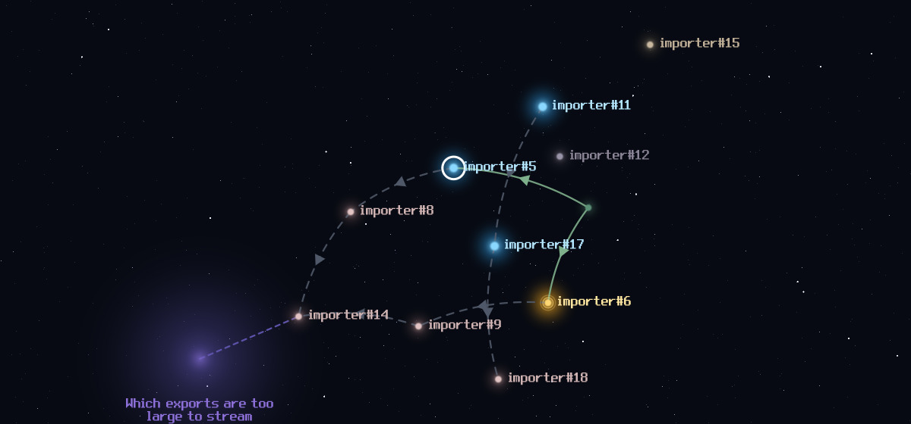

# wayfinder-starmap

A Claude Code plugin that draws your **wayfinder maps** as an interactive star map in a pane: every ticket a
star, every blocking link a lane, open questions as fog. `/maps` opens it beside your session.



- **Read a plan at a glance.** Frontier tickets (ready to take) glow blue, claimed ones gold, blocked ones dim;
  closed blockers stay as faint dots so the lanes still connect.
- **Move around it.** Drag to pan, wheel or `+` `-` to zoom, `f` to fit, `Tab` to walk the frontier.
- **Open a ticket.** Click a star (or `Enter` on the selected one) to read its body under the map.
- **See what is wrong with the map.** Counts, the tickets by rank, fog patches and lint are listed under the
  picture: closed tickets the map does not index, blockers that are not on it, cycles, a missing destination.

## Requirements

- **Claude Code** that runs plugin hooks modules (built and tested on 2.1.302 and 2.1.303).
- **A terminal that draws kitty graphics**, outside tmux: Ghostty, kitty, WezTerm, or cmux. Elsewhere the pane
  still lists the maps and tickets and says why it draws no picture.
- **One of:**
  - **GitHub:** the [GitHub CLI](https://cli.github.com) (`gh`), signed in with `gh auth login`.
  - **Forgejo:** Forge-Tools' `hub-api`, configured for your forge.

## Install

At the prompt of a Claude Code session:

```
/plugin install wayfinder-starmap --marketplace CircuitBoardGames/wayfinder-starmap
```

Answer `y` to add the marketplace, then pick a scope. The install asks for the settings below.

## Configure

| Setting | Default | What it is |
|---|---|---|
| `repo` | *(none)* | The `owner/repo` whose issues hold your maps. Required. |
| `source` | `github` | `github` reads through `gh`; `forgejo` reads through `hub-api`. |
| `ghCommand` | `gh` | The GitHub CLI to run. |
| `hubApiCommand` | `hub-api` | Forge-Tools' `hub-api`, for a Forgejo tracker. |

Change them in `/config`, or in `settings.json`, under the installed plugin's id:

```json
{
  "pluginConfigs": {
    "wayfinder-starmap@wayfinder-starmap": { "options": { "repo": "your-org/your-repo", "source": "github" } }
  }
}
```

The plugin holds no token: every read is `gh` or `hub-api`, with whatever credentials those already have.

## Use

- `/maps` opens the pane on your lowest-numbered open map; `/maps #12` opens the map in issue #12.
- Pick another map from the list at the top. **Refresh** re-reads it (the pane also refreshes itself every
  three minutes while open).
- **Center** returns the picture to the whole map.

## The map format

A wayfinder map is an ordinary issue labelled **`wayfinder:map`**.

**Children.** The map's tickets, in order, are the `- #N` lines between two markers in its body:

```markdown
## Children

<!-- wayfinder:children -->
- #12
- #13
<!-- /wayfinder:children -->
```

On GitHub, a map with no such block uses its **sub-issues** instead.

**Sections.** The map body's `##` sections index the route:

- **`## Destination`:** where the map is going; its first line heads the pane.
- **`## Decisions so far`:** a bullet per settled ticket (`- #12 ...` or a link to it).
- **`## Out of scope`:** a bullet per ticket ruled out.
- **`## Not yet specified`:** fog. Each bullet is a bolded question, optionally `clears-with: #N`. Strike a
  bullet through (`- ~~**...**~~`) once it graduates into a ticket.

**Blockers.** On GitHub they are an issue's *blocked by* links; on Forgejo, its dependencies.

**Labels.** A ticket's type is its `wayfinder:research`, `wayfinder:prototype`, `wayfinder:grilling` or
`wayfinder:task` label. `wayfinder:latent` marks one open on purpose, and `wayfinder:waiting-operator` one
waiting on a person.

**Statuses.** A ticket's status is derived, never stored:

| Status | When |
|---|---|
| ✓ resolved | closed |
| ✗ out of scope | closed, and listed under Out of scope |
| ◌ latent | open, labelled `wayfinder:latent` |
| ⏸ waiting | open, labelled `wayfinder:waiting-operator` |
| ● claimed | open and assigned |
| ○ blocked | open, with a blocker still open |
| ★ frontier | open, and nothing above applies: ready to take |

A ticket's rank is one past its deepest blocker on the map, so every blocker is listed, and drawn, before what
it blocks.

## Develop

```
claude plugin validate .
claude plugin test .
```

The tests drive the plugin through Claude Code's own test kit: the pane, the star map's pointer and keys, both
trackers (their commands answered by the test), and the picture's pixels.

## License

The code is MIT licensed; see [LICENSE](LICENSE).

The label font is **Replace The Sun** by Imirui ([dafont.com/replacethesun.font](https://www.dafont.com/replacethesun.font),
listed there as 100% Free), kept as glyph data in `hooks/font.ts`. It is not covered by the MIT licence and
keeps its author's terms.
